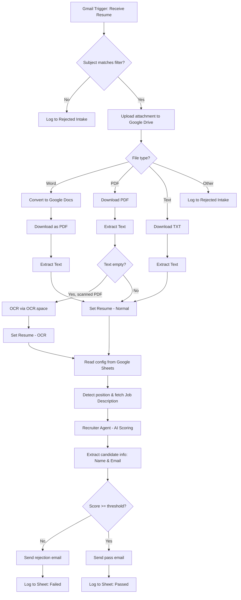

# CV Screener — n8n Automation Workflow

An n8n-based workflow that automates resume screening end-to-end:
monitors incoming email, extracts CV content (PDF, Word, or plain
text — including scanned PDFs via OCR), evaluates each candidate
against the job description using an LLM, sends an automated reply
(pass/fail), and logs every result to Google Sheets.

> **Impact:** Reduces manual resume screening from 5+ hours per
> batch to under 30 minutes — without a recruiter touching a single
> email.

> Workflow file: [`cv-screener-workflow.json`](./cv-screener-workflow.json) —
> ready to import into n8n. All Google Drive/Sheets IDs, webhook IDs,
> and API keys have been replaced with placeholders (see
> [Configuration](#configuration)).

## Features

- **Gmail intake** — monitors inbox every minute, filters emails by
  subject keywords (`apply`, `cv`, `hr`, `lamar`, etc.).
- **Multi-format resume support** — handles PDF, Word (`.docx`,
  auto-converted to Google Docs → PDF), and plain text attachments.
- **OCR fallback** — if a PDF is image-only (no extractable text),
  content is retrieved via [OCR.space](https://ocr.space) API.
- **AI-powered evaluation** — an LLM agent (via OpenRouter) compares
  the candidate's CV against the job description, producing a match
  score (0–10), strengths/weaknesses, and a structured risk/reward
  analysis.
- **Spreadsheet-driven config** — open positions, subject keywords,
  pass threshold, job description file IDs, and email templates are
  all managed in a single Google Sheets config file — no workflow
  edits needed.
- **Auto-reply + logging** — sends a pass/fail email to each candidate
  automatically, and logs every result (including intake rejections)
  to separate Google Sheets tabs.

## Workflow



## Prerequisites

- An [n8n](https://n8n.io) instance (self-hosted or cloud) with
  LangChain nodes enabled (`@n8n/n8n-nodes-langchain`).
- A Google account with access to:
  - **Gmail** (read incoming emails & send replies)
  - **Google Drive** (store CV attachments and job description files)
  - **Google Sheets** (config spreadsheet & result logs)
- An **[OpenRouter](https://openrouter.ai)** account for LLM access
  (default model: `openai/gpt-4o-mini`).
- An **[OCR.space](https://ocr.space/ocrapi)** API key (free tier
  available) for scanned PDF fallback.

## Configuration

After importing `cv-screener-workflow.json` into n8n:

1. **Re-link all credentials** — connect Gmail, Google Drive, Google
   Sheets, and OpenRouter nodes to your own accounts (n8n will prompt
   you automatically since credentials are genericised in the exported
   file).
2. **Replace the following placeholders** with your own values:

   | Placeholder | Node | Description |
   |---|---|---|
   | `YOUR_DRIVE_FOLDER_ID` | `Upload to Drive` | Google Drive folder ID for CV uploads |
   | `YOUR_SPREADSHEET_ID` | `Get row(s) in sheet`, `⚠️ Rejected Intake`, `✅ Passed`, `❌ Failed` | ID of the config & log spreadsheet |
   | `YOUR_OCR_SPACE_API_KEY` | `Extract Text from PDF` (header `apikey`) | OCR.space API key |
   | `YOUR_WEBHOOK_ID` | `Send Rejection Email`, `Send Acceptance Email` | Usually auto-regenerated by n8n on import; verify if conflicts arise |

3. **Set up the Google Spreadsheet** with at least 4 tabs (headers on
   row 2, data from row 3 — matching the `headerRow`/`firstDataRow`
   settings in each node):
   - `⚙️ CONFIG` — columns: `PARAMETER`, `VALUE`, `DATA TYPE`,
     `REQUIRED?` (contains: active positions, subject keywords, job
     description file IDs, minimum pass score, and pass/fail email
     templates).
   - `⚠️ Rejected Intake` — log of emails rejected at intake (wrong
     format or subject).
   - `✅ Passed` — log of candidates who passed screening.
   - `❌ Failed` — log of candidates who failed screening.
4. Activate the workflow (`active: true`) once all credentials and
   placeholders are filled.

## File Structure

```
.
├── cv-screener-workflow.json   # n8n workflow (sanitised — all credentials replaced with placeholders)
└── README.md
```

## Known Limitations

- **Single-position intake per email** — the workflow detects one job
  position per incoming email. A candidate applying to two positions
  in one email will only be evaluated against the first match.
- **OCR accuracy depends on scan quality** — low-resolution or skewed
  scans may produce garbled text, affecting LLM scoring accuracy. No
  retry logic is currently implemented.
- **LLM scoring is non-deterministic** — the same CV may receive a
  score difference of ±1 across runs. The pass threshold should be
  set with this margin in mind.
- **No duplicate detection** — the same email address can be logged
  multiple times if the same candidate resubmits.
- **Google Sheets as operational DB** — suitable for low-to-medium
  volume (dozens of applications per day). High-volume use cases
  would require a proper database backend.

## Security Note

This workflow file is a **portfolio version** — all Google
Drive/Sheets IDs, webhook IDs, API keys, and credential account
names have been replaced with generic placeholders before publishing.
Workflow structure, node connections, and logic are unchanged and
can be studied or re-imported after filling in your own values.

## License

Shared for portfolio and learning purposes. Free to use and modify.
