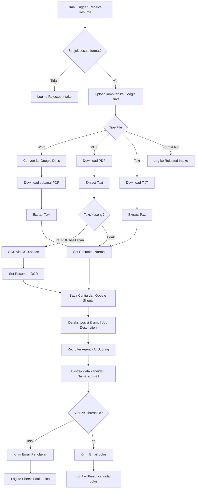

# CV Screener — n8n Automation Workflow

Workflow otomatisasi berbasis [n8n](https://n8n.io) yang menyaring lamaran kerja secara otomatis: memantau email masuk, mengekstrak CV (PDF/Word/Text, termasuk hasil scan lewat OCR), membandingkannya dengan deskripsi pekerjaan menggunakan LLM, lalu mengirim email balasan (lolos/tidak) dan mencatat hasilnya ke Google Sheets.

> File workflow: [`cv-screener-workflow.json`](./cv-screener-workflow.json) — siap di-import ke n8n. Semua ID Google Drive/Sheets, webhook ID, dan API key pada file ini sudah diganti dengan placeholder (lihat bagian [Konfigurasi](#konfigurasi)).

## Fitur

- **Intake via Gmail** — memantau inbox setiap menit, memfilter email berdasarkan subjek (mengandung kata seperti `lamar`, `apply`, `cv`, `hr`, dst).
- **Multi-format resume** — mendukung lampiran PDF, Word (`.docx`, dikonversi otomatis ke Google Docs → PDF), dan Text.
- **OCR fallback** — jika PDF hasil scan (tidak ada teks yang bisa diekstrak langsung), teks diambil lewat [OCR.space](https://ocr.space) API.
- **Penilaian berbasis AI** — sebuah AI agent (LLM via OpenRouter) membandingkan CV kandidat dengan deskripsi pekerjaan, lalu menghasilkan skor kecocokan (0–10), kekuatan/kelemahan kandidat, serta analisis risiko dan potensi (risk & reward) dalam format terstruktur.
- **Konfigurasi berbasis Google Sheets** — posisi yang dibuka, kata kunci pencocokan subjek, threshold skor kelulusan, ID file deskripsi pekerjaan, dan template email semuanya diatur lewat satu spreadsheet konfigurasi (tanpa perlu ubah workflow).
- **Auto-reply & logging** — mengirim email lolos/tidak lolos secara otomatis ke kandidat, lalu mencatat hasilnya (termasuk lamaran yang ditolak di tahap intake) ke Google Sheets terpisah.

## Alur Kerja



## Prasyarat

- Instance [n8n](https://n8n.io) (self-hosted atau cloud) dengan node LangChain aktif (`@n8n/n8n-nodes-langchain`).
- Akun Google dengan akses ke:
  - **Gmail** (baca email masuk & kirim email balasan)
  - **Google Drive** (menyimpan lampiran CV & menyimpan file deskripsi pekerjaan)
  - **Google Sheets** (spreadsheet konfigurasi & log hasil)
- Akun **[OpenRouter](https://openrouter.ai)** untuk akses model LLM (default: `openai/gpt-4o-mini`).
- API key **[OCR.space](https://ocr.space/ocrapi)** (free tier tersedia) untuk fallback OCR pada PDF hasil scan.

## Konfigurasi

Setelah meng-import `cv-screener-workflow.json` ke n8n, lakukan langkah berikut:

1. **Set ulang semua credentials** — hubungkan node Gmail, Google Drive, Google Sheets, dan OpenRouter ke akun/kredensial Anda sendiri (n8n akan meminta ini otomatis karena kredensial pada file di-generic-kan).
2. **Ganti placeholder berikut** dengan nilai milik Anda:

   | Placeholder | Lokasi (node) | Keterangan |
   |---|---|---|
   | `YOUR_DRIVE_FOLDER_ID` | `Upload to Drive` | ID folder Google Drive tujuan upload CV |
   | `YOUR_SPREADSHEET_ID` | `Get row(s) in sheet`, `⚠️ Rejected Intake`, `✅ Kandidat Lolos`, `❌ Tidak Lolos` | ID Google Spreadsheet konfigurasi & log |
   | `YOUR_OCR_SPACE_API_KEY` | `Extract Text from PDF` (header `apikey`) | API key dari OCR.space |
   | `YOUR_WEBHOOK_ID` | `Send Rejection Email`, `Send Acceptance Email` | Biasanya di-generate ulang otomatis oleh n8n saat import; cek kembali jika ada konflik |

3. **Siapkan Google Spreadsheet konfigurasi** dengan minimal 4 sheet/tab berikut (header di baris ke-2, data mulai baris ke-3, mengikuti setting `headerRow`/`firstDataRow` pada node):
   - `⚙️ CONFIG` — kolom `PARAMETER`, `NILAI / VALUE`, `TIPE DATA`, `WAJIB?` (berisi daftar posisi aktif, kata kunci subjek, ID file job description, threshold skor minimum, dan template email lolos/tidak lolos).
   - `⚠️ Rejected Intake` — log lamaran yang ditolak di tahap awal (format tidak sesuai).
   - `✅ Kandidat Lolos` — log kandidat yang lolos screening.
   - `❌ Tidak Lolos` — log kandidat yang tidak lolos screening.
4. Aktifkan workflow (`active: true`) setelah semua kredensial dan placeholder terisi.

## Struktur File

```
.
├── cv-screener-workflow.json   # Workflow n8n (sudah dibersihkan dari data sensitif)
└── README.md
```

## Catatan Keamanan

File workflow ini adalah versi **portofolio** — seluruh ID Google Drive/Spreadsheet, webhook ID, API key, dan nama akun kredensial telah diganti dengan placeholder generik sebelum di-publish. Struktur node, koneksi antar node, dan logika workflow tidak diubah, sehingga tetap bisa dipelajari dan di-import ulang ke n8n setelah placeholder diisi dengan nilai milik Anda sendiri.

## Lisensi

Workflow ini dibagikan untuk tujuan portofolio/pembelajaran. Silakan gunakan dan modifikasi sesuai kebutuhan Anda.
